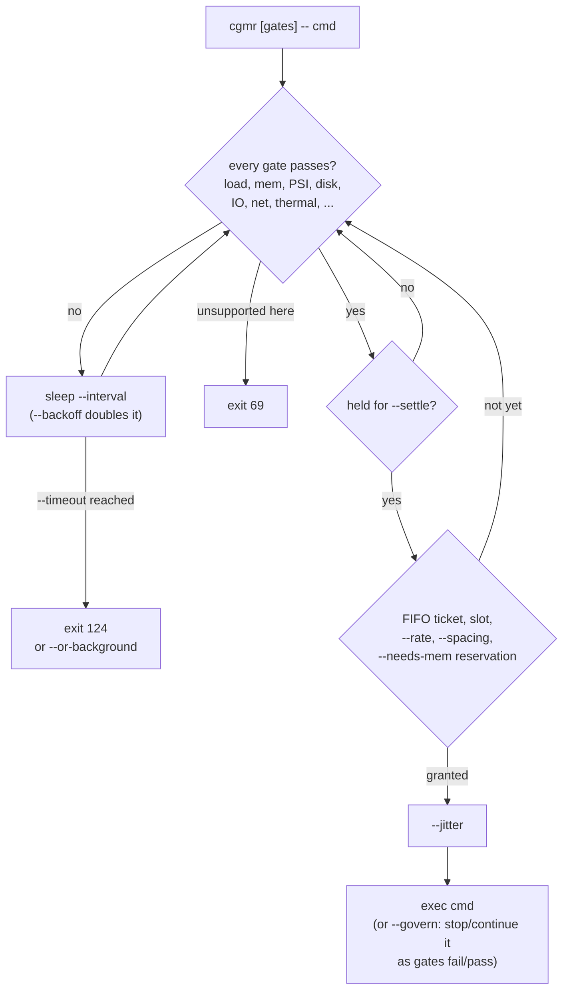

# congestimancer

<!-- hallucinogen:autonomy-disclaimer start -->
> Read [LLM-DISCLAIMER](docs/LLM-DISCLAIMER.md) first. This repository is
> tended by an autonomous loop, and that file says what the loop may do here,
> what it may not, and what to check before trusting anything in this tree.
<!-- hallucinogen:autonomy-disclaimer end -->

<!-- BEGIN badges: generated by `cargo run -p congestimancer-dev -- readme`; do not edit -->
[](https://github.com/pr0d1r2/congestimancer/actions/workflows/ci.yml)
[](LICENSE)
[](Cargo.toml)
[](Cargo.toml)
[](docs/THIRD-PARTY-NOTICES.md)
[](Cargo.toml)

[](hk.pkl)
[](hk.pkl)
[](.coverage)
[](SPEC.md)
[](SPEC.md)
[](SPEC.md)

[](flake.nix)
[-5277C3?logo=nixos&logoColor=white)](flake.lock)
[](.github/workflows/ci.yml)
[](.github/workflows/ci.yml)
[](.github/workflows/ci.yml)

[](https://claude.com/claude-code)
[](SPEC.md)
<!-- END badges -->

`cgmr` holds a command until the machine has room for it. Load, memory,
disk, IO, pressure, thermals and a few dozen other gates must pass first;
then it `exec`s your command, so exit codes and signals pass straight
through.

```sh
cgmr --load 1 --mem 2GB -- make -j8   # wait for room, then run
cgmr check --load 1 --disk 5GB        # one-shot yes/no for scripts
cgmr advise --jobs 8 --json           # how much parallel work fits now
```

## Why?

Machines that do several things at once run out of room in bursty ways. A
coding agent fans out eight `cargo test` runs. A pre-push hook starts a
coverage build while a nix rebuild is still swapping. Three CI jobs on one
self-hosted runner hit their link step in the same second. Each of these
works alone and takes the box down together.

The usual fixes are crude. `nice` lowers priority but still starts the
work. `xargs -P` and `make -j` cap concurrency inside one process tree and
know nothing about the rest of the machine. `batch` from `at` waits on one
number, the load average, which lies inside a container and says nothing
about memory or IO. A hand-written `while [ "$(cut -d' ' -f1 /proc/loadavg)" ... ]`
loop works until everyone writes one and they all wake at once.

cgmr reads the signals that actually predict trouble (pressure stall
information, available memory, swap rate, IO latency, run queue, thermal
throttling), compares them with thresholds you give it, and only then
starts the command. Waiters coordinate through per-user lock files, so
slots, FIFO order, start rates and memory reservations hold across
unrelated processes, and a herd of waiters does not stampede when the
machine frees up.

## How?



Every gate compares one signal with one threshold and passes only when the
machine is strictly better than it. All gates must pass. A gate the
current OS cannot measure fails with exit 69; it never passes silently.

## What it measures

| Family | Gates |
| --- | --- |
| CPU | load average (per CPU or absolute), run queue, idle percent, CPU pressure, steal |
| Memory | available memory, memory pressure, macOS memory level, swap rate, dirty pages, reservations by other cgmr jobs |
| Disk | free space and inodes on a path; read and write rate, busy percent, latency, queue depth, IO pressure of the device behind it |
| Network | receive and transmit rate per interface, TCP connect round trip to a host |
| Limits | open files and processes against the system maximum |
| Thermal and power | throttling, temperature, on AC, battery level, low-power mode |
| Presence and time | user idle time, a daily clock window |
| GPU | utilisation and free memory (NVIDIA, AMD, Apple) |
| Processes | how many processes match a name or belong to a user |
| Containers | cgroup v2 limits, pressure and CPU throttling of the current cgroup |
| Elsewhere | the same gates evaluated on another host over ssh; any shell command or file as a custom gate |

The full catalogue, with each source and its semantics, is
[docs/CONGESTION.md](docs/CONGESTION.md). Linux and macOS are supported, on
x86_64 and aarch64; the catalogue ends with a per-OS support matrix.

## Installation

From source with cargo (Rust 1.95 or newer):

```sh
cargo install --git https://github.com/pr0d1r2/congestimancer
```

With nix:

```sh
nix run github:pr0d1r2/congestimancer -- status
nix profile install github:pr0d1r2/congestimancer
```

Other flakes can add `cgmr` to their packages through `overlays.default`;
see [docs/INTEGRATION.md](docs/INTEGRATION.md).

## Usage

```sh
# Wait for room, then run. The command always comes after `--`.
cgmr --load 1 --mem-pressure 10 --swap-rate 1MB/s -- cargo build --release

# At most two heavy builds at once across every shell, in arrival order.
cgmr --slots 2 --slot-key build --fifo -- nix build .#iso

# Reserve memory: the next waiter sees 4GiB already spoken for.
cgmr --needs-mem 4GiB -- ./train.sh

# Inside a container, trust the cgroup, not the host's load average.
cgmr --cgroup auto --cpu-pressure 20 -- make -j"$(nproc)"

# Only at night, only when nobody is at the keyboard, only on AC.
cgmr --between 22:00-06:00 --idle 10m --on-ac -- ./backup.sh

# Ask before fanning out.
cgmr advise --jobs 8 --needs-mem 2GiB --json
# {"schema_version":1,"jobs":3,"limit":"mem","action":"reduce","blocking":[]}

# What does this machine look like right now?
cgmr status
```

Every switch also reads an environment variable (`--needs-mem` reads
`CGMR_NEEDS_MEM`), and named sets of switches live in profiles: a `.cgmr`
file in the project or `~/.config/cgmr/profiles`.

- [docs/CLI.md](docs/CLI.md): verbs, environment, profiles and exit codes.
- [docs/CONGESTION.md](docs/CONGESTION.md): every gate and strategy.
- [docs/INTEGRATION.md](docs/INTEGRATION.md): hk, lefthook, CI, make,
  xargs and coding agents.
- [docs/SECURITY.md](docs/SECURITY.md): what cgmr trusts and what it
  refuses.

## Exit codes

| Code | Meaning |
| --- | --- |
| 0 | gates passed and there is no command; `check`: every gate passed |
| 1 | `check`: a gate failed |
| 64 | usage error |
| 69 | a gate is unsupported on this machine |
| 124 | `--timeout` ran out |
| 130, 143 | SIGINT or SIGTERM while waiting |
| N | once the command runs, its own exit code |

A command that itself exits 64, 69 or 124 looks like cgmr's own; see
[docs/CLI.md](docs/CLI.md#the-exit-code-collision).

## As a library

The `congestimancer` crate re-exports the gate model, the signal readers
and the evaluation loop, so a tool or agent can read congestion without
spawning `cgmr`.

## What's NOT here

- No daemon. Each `cgmr` reads the machine when it runs; coordination is
  lock files in a per-user 0700 directory, released by the kernel when a
  process dies.
- No scheduler. cgmr decides *when* a command starts, never which command
  runs next; FIFO order applies only among waiters that ask for it.
- No resource enforcement. Once started, the command is not throttled or
  killed. `--background` lowers its priority, and `--govern` pauses and
  resumes it as the gates fail and pass.
- No network calls of its own. Only `--rtt` (a TCP connect you name) and
  `--host` (your own `ssh`) touch the network.
- No Windows, no BSD.

## Status

`0.1.0-rc.1` is the first release candidate. 0.1 is a development series,
not for production; the command line and the JSON schema (`schema_version`

1) may still change before the stable 0.2.

## Contributing

See [CONTRIBUTING.md](CONTRIBUTING.md). The spec in [SPEC.md](SPEC.md) is
the law the code is built against, and [AGENTS.md](AGENTS.md) is how coding
agents work in this repository. The project is written with an LLM, in the
open: [docs/LLM-DISCLAIMER.md](docs/LLM-DISCLAIMER.md).

## License

MIT, see [LICENSE](LICENSE). Third-party crates and their licences:
[docs/THIRD-PARTY-NOTICES.md](docs/THIRD-PARTY-NOTICES.md).
